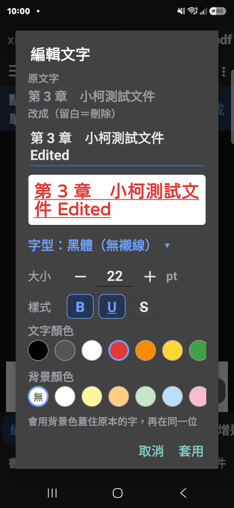
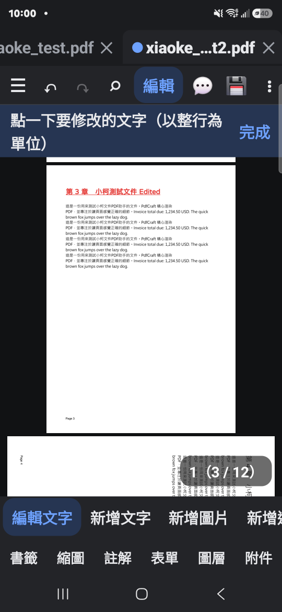
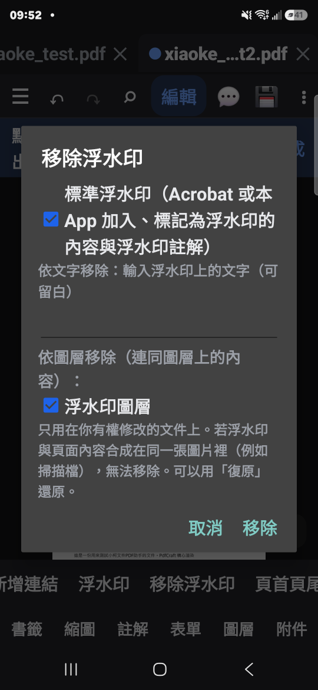
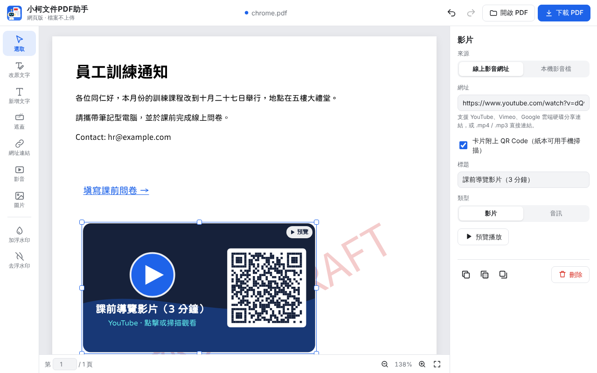

# 小柯文件PDF助手（XiaoKePdf）https://achir1015.github.io/xiaoke-pdf/

PDF 閱讀與編輯工具，有 **Android App** 與 **免安裝網頁版** 兩種，功能參考 [PdfCraft](https://github.com/PDFCraftTool/pdfcraft)。
閱讀、編輯文字、註解、填表、簽署、整理頁面、合併分割、加密、塗銷、移除浮水印……全部在手機或瀏覽器上完成。

**隱私至上：文件絕對不會離開你的裝置。** 不需要帳號、不收集使用資料、沒有雲端處理。App 只有按「檢查更新」時會連到 GitHub 查詢新版；網頁版只會下載程式函式庫與中文字型，PDF 本身不會傳出去。

  

## 🌐 網頁版（免安裝，電腦、手機都能用）

**👉 [開啟小柯文件PDF助手網頁版](https://achir1015.github.io/xiaoke-pdf/)**

（GitHub Pages 已開啟，請用上面的正式網址。備用網址 **[raw.githack](https://raw.githack.com/achir1015/xiaoke-pdf/gh-pages/index.html)** 也是讀 `gh-pages` 分支，但它有快取，**更新後可能要等一段時間才會是新版**，所以只在正式網址打不開時使用。）

打開網頁、把 PDF 拖進去就能編輯，改好按「下載 PDF」。檔案全程在你的瀏覽器裡處理，**不會上傳**。



| 工具 | 可以做什麼 |
|---|---|
| ✏️ **改原文字** | 原本的文字會用藍框標出，點一下那一行就能直接改。**直書（由上往下）的文字也可以**：瀏覽器列印、Word 匯出、直書字型三種直書 PDF 都認得，改完仍是直書。下載時舊字會從檔案裡真正刪除（不只是蓋住），搜尋、複製都不會再出現 |
| 🔤 **新增文字** | 中文使用內建的 jf open 粉圓字型，存檔後是可以搜尋、複製的真正文字；橫書／直書、字級、顏色、背景色、粗體、底線、刪除線、對齊、行高。直書時中文直立、英數字橫躺、括號自動換成直書字形 |
| 🩹 **遮蓋** | 像修正帶一樣框出要蓋掉的區域，可以從頁面取樣背景色 |
| 🔗 **網址連結** | 點一下插入可點擊的文字連結；框選則在原本的字上加一塊透明點擊區。自動補 `https://`，中文網址自動轉碼，也支援 Email、電話 |
| ▶️ **影音** | 放一張播放卡片：YouTube／影片網址（整張卡片可點，附 QR Code，印成紙本也能掃），或把本機影片、音訊檔直接嵌入 PDF 成為附件。編輯時可以在卡片上直接預覽播放 |
| 🖼️ **圖片** | PNG、JPG、WebP… 拖曳改大小時保持比例（按 Shift 自由變形）；也可以直接把圖片拖進頁面 |
| 💧 **加浮水印** | 文字或圖片浮水印；透明度、角度、置中／滿版重複／頁首／頁尾、蓋在上方或墊在下方、指定頁碼（`1-3,5`、`奇數`）。頁面上即時預覽 |
| 🚫 **去浮水印** | 自動分析文件：① 標準浮水印（Acrobat、小柯 App、本網頁加的）② 依文字移除（會先告訴你會刪掉幾個區塊）③ 依圖層移除 ④ 每頁重複的 Logo 圖片 |

 

其他：每一步都可以**復原／重做**（加、去浮水印也可以）、旋轉過的頁面也能正確編輯、手機上工具列在底部、屬性面板變成底部抽屜。

**快捷鍵**：`V` 選取、`E` 改原文字、`T` 文字、`R` 遮蓋、`L` 連結、`M` 影音、`I` 圖片、`W` 加浮水印、`U` 去浮水印、`Delete` 刪除、`Enter` 編輯文字、方向鍵微調（加 Shift 一次 10 點）、`Ctrl+Z / Ctrl+Y` 復原／重做、`Ctrl+D` 複製、`Ctrl+S` 下載、`Ctrl + 滾輪` 縮放。

> **使用限制**：有密碼保護的 PDF 請先用 App 的「移除保護」；掃描檔（整頁是圖片）裡的字無法直接改，請用「遮蓋」＋「新增文字」；浮水印如果和內容一起印在掃描圖片裡也無法分離。PDF 沒有所有閱讀器都通用的影片播放方式，所以網址影音是「可點擊的卡片」，嵌入的影音檔是「附件」（Acrobat、Foxit 點迴紋針即可播放）。

### 網頁版的程式結構


純 HTML + JavaScript（ES 模組），不需要編譯。依「領域模型」分層：

```
web/
├─ index.html              畫面骨架與函式庫網址（importmap，固定版本）
├─ css/app.css             樣式（淺色／深色、手機版）
└─ js/
   ├─ domain/              領域模型：不碰畫面、不碰 PDF 函式庫
   │  ├─ elements.js       頁面上的「貼紙」：文字、遮蓋、連結、影音、圖片
   │  ├─ session.js        編輯工作階段：底稿 + 貼紙 + 歷史快照（復原／重做）
   │  └─ page.js           頁面幾何：螢幕座標 ⇄ PDF 座標（處理旋轉頁）
   ├─ pdf/                 PDF 加工：pdf.js 繪製、pdf-lib 寫入
   │  ├─ renderer.js       繪製頁面、讀出文字行位置
   │  ├─ exporter.js       把貼紙印到 PDF
   │  ├─ textEraser.js     刪除被取代的原文字
   │  ├─ watermarkAdder.js / watermarkRemover.js   加／去浮水印（規則與 Android 版相同）
   │  ├─ contentStream.js  PDF 繪圖指令解析器
   │  ├─ fontDecoder.js    字碼 → 文字（ToUnicode 對照表）
   │  ├─ fonts.js          粉圓字型載入與 HarfBuzz 子集化
   │  └─ media.js          影音播放卡片與 QR Code
   └─ ui/                  畫面：App 主控制器、文件畫面、屬性面板
```

**在自己電腦上執行**：在專案根目錄執行 `python -m http.server 8000`，再打開 <http://localhost:8000/web/>（需要網路下載函式庫；中文字型會自動從 GitHub 讀取）。

**發佈**：推到 `main` 後，GitHub Actions（`.github/workflows/pages.yml`）會把 `web/` 和中文字型組合好推到 `gh-pages` 分支。第一次使用請到倉庫的 **Settings → Pages**，Source 選 **Deploy from a branch**、Branch 選 **gh-pages / (root)**，按 Save。

## 🌐 完整版線上版（小柯文件PDF線上版）

**[👉 開啟完整版線上版](https://achir1015.github.io/xiaoke-pdf/online/)** — 功能與 Android App 相同（閱讀、註解、填表、簽署、整理頁面、合併分割、加密、塗銷、加／去浮水印…），手機、平板、電腦的瀏覽器都能用。


- **像 Word 一樣編輯**：按「編輯」→ 點一下頁面上的文字，原本的位置就變成編輯框，游標在你點的地方，直接打字；整段文字會自動換行，舊字會從檔案裡真正刪除。上方格式列可以改字型、大小、粗體、底線、刪除線、文字顏色、背景色。點空白處可以直接新增文字。
- **檔案不會上傳**：所有處理都在瀏覽器裡完成（pdf.js、pdf-lib），網站只提供程式本身。
- **安裝到主畫面 / 建立捷徑**：Android Chrome「⋮ → 加到主畫面 / 安裝應用程式」；iPhone Safari「分享 → 加入主畫面」；電腦版 Chrome / Edge 按網址列的「安裝」圖示。安裝後有小柯機器人圖示，離線也能用。
- **更新通知**：網站有新版時，畫面上方會出現「有新版本」通知，按「立即更新」即可。
- 程式在 `docs/`（不需要編譯，函式庫都放在 `docs/vendor/`）；在自己電腦上執行：`python -m http.server 8000 -d docs`，再打開 <http://localhost:8000/>。發佈時由同一個 GitHub Actions 放到 `gh-pages` 分支的 `online/`。

## 📱 Android App

### 📲 下載安裝（Android 7.0 以上）

**[⬇️ 下載 XiaoKePdf.apk（v1.1.0）](https://github.com/achir1015/xiaoke-pdf/raw/main/release/XiaoKePdf.apk)**

也可以到 [Releases 頁面](https://github.com/achir1015/xiaoke-pdf/releases/latest) 下載。


1. 用手機開上面的連結，或用相機掃 QR Code 下載 APK（約 19 MB）。
2. 下載完成後點開檔案。如果出現「為了安全起見，你的手機目前無法安裝來自這個來源的應用程式」，按「設定」→ 開啟「允許來自這個來源的應用程式」→ 返回再按「安裝」。
3. 三星手機如果被 Play Protect 擋下，選「更多詳細資料」→「仍要安裝」。
4. 安裝後打開「小柯文件PDF助手」，按「開啟檔案」選 PDF；也可以從 LINE、Gmail、檔案管理等 App 用「分享」或「開啟方式」把 PDF 交給它。
5. 之後要更新：在 App 首頁最下方（或「⋮ → 設定」）按「檢查更新」，有新版會自動下載並開啟安裝畫面，直接安裝覆蓋即可，開著的文件與設定都會保留。第一次更新時，Android 會要求允許本 App「安裝未知應用程式」。

## App 功能

### 閱讀
- 連續捲動、單頁、雙頁、檢視旋轉、全螢幕無干擾閱讀
- 放大後只重繪看得到的區塊，放多大文字都清晰
- 淺色 / 深色主題、夜間頁面（反白）、護眼色
- 多分頁：未儲存的分頁有圓點、長按分頁可關閉其他、重新開啟上次關閉的分頁、顯示檔案
- 書籤（可搜尋，保留上層脈絡）、頁面縮圖、文件自己的頁面標籤（i、ii、1、2…）
- 搜尋整份文件，逗號分隔可同時找多個詞；長按選取文字、複製、分享
- 受損的檔案會自動修復；加密檔案輸入密碼即可開啟，並遵守作者設定的權限

### 編輯
- **像 Word 一樣編輯文字**：點一下頁面上的文字，原本的位置直接變成編輯框，游標在點到的地方；整段一起改、自動換行，舊字會從檔案裡真正刪除
- **格式列**：字型（黑體／明體／等寬）、大小、文字顏色、背景顏色、粗體、底線、刪除線
- **表格**：插入表格（下面的內容自動往下移）、插入列、插入欄、合併儲存格；表格裡的字只在那一格裡編輯、在格子寬度內換行，字變長時那一列自動撐高（頁面放不下才縮小字級）
- 中文使用內建的開放授權字型，寫入後是可以搜尋、複製的真正文字
- 新增圖片、連結、浮水印、頁首頁尾與頁碼、裁切頁面、頁面標籤、書籤
- **移除浮水印**：標準浮水印（Acrobat 或本 App 加入的）、依文字移除、依圖層移除

### 註解、表單與簽署
- 便利貼、螢光筆、底線、刪除線、波浪線、文字框、矩形、橢圓、直線、箭頭、手繪、印章
- 註解面板：回覆、審閱狀態、改顏色 / 不透明度 / 線寬、刪除
- 表單：填寫文字、核取方塊、選項按鈕、下拉選單、清單；標示欄位、清除、平面化；自己建立表單欄位
- 填寫與簽署：手寫簽名（可儲存重複使用）、日期、勾選、縮寫
- 數位簽章：用 .p12 / .pfx 憑證簽署（可見或不可見）、驗證簽章、建立自簽憑證

### 頁面與檔案
- 整理頁面：多選、旋轉、刪除、插入空白頁、從其他檔案插入、前後移動、反轉、擷取
- 合併多個 PDF（每個檔案一個書籤，原本的書籤放在底下）、擷取頁面、每 N 頁分割、指定頁前分割
- 建立 PDF：圖片轉 PDF、空白文件、文字、相機掃描
- 匯出：圖片（PNG / JPG）、純文字、Word（.docx）
- 壓縮 PDF、列印、轉灰階、比較兩份文件的文字差異

### 安全與隱私
- 密碼保護（AES-256）與權限設定、移除保護、移除隱藏資訊
- 塗銷：框選或搜尋後永久移除內容
- 文件屬性：標題、作者、主旨、關鍵字可編輯；字型與嵌入狀態、PDF 版本、頁面大小、完整安全性資訊

### 可靠的儲存
- 每次編輯都是一個步驟，可以一直復原 / 重做，**儲存後仍然可以復原**
- 存檔前先寫到暫存檔並驗證，再覆蓋原檔
- 每分鐘自動保存；App 意外結束後，下次開啟會詢問是否恢復未儲存的工作

### 工具
- 所有工具目錄、指令面板（搜尋所有工具和指令）
- 測量距離與面積（可設比例尺）、無障礙檢查與修正、引導式動作（發佈前清理、寄送前準備、封存、匯出註解）

> OCR 文字辨識還在開發中（預計 v1.2）。

## App 編譯（不用 Gradle）

需要 Python 3.8+、JDK 17、Android SDK（build-tools 34.0.0、platforms/android-34）。
在專案根目錄建立 `local.properties`：

```properties
sdk.dir=C:\\Android\\Sdk
jdk.dir=C:\\Program Files\\Java\\jdk-17
```

```bash
python build.py
```

產生 `build/XiaoKePdf.apk`。加上 `install` 參數會用 adb 安裝並啟動。第一次編譯會自動產生簽章金鑰 `xiaokepdf.jks`（不會上傳到 GitHub）。

## 使用的開放原始碼與授權

| 元件 | 用途 | 授權 |
|---|---|---|
| [PDFBox-Android](https://github.com/TomRoush/PdfBox-Android) 2.0.27.0 | PDF 解析、編輯、文字擷取 | Apache 2.0 |
| [Bouncy Castle](https://www.bouncycastle.org/) 1.72 | 數位簽章 | MIT |
| [jf open 粉圓](https://github.com/justfont/open-huninn-font) 2.1 | 寫入 PDF 的中文字型（App 與網頁版共用） | SIL Open Font License 1.1（漢字部分源自 Kosugi Maru，Apache 2.0），授權全文見 `assets/fonts/jf-openhuninn-OFL.txt` |

頁面繪製使用 Android 內建的 PdfRenderer。

網頁版另外使用：

| 元件 | 用途 | 授權 |
|---|---|---|
| [PDF.js](https://github.com/mozilla/pdf.js) 6.4 | 繪製頁面、讀取文字位置 | Apache 2.0 |
| [pdf-lib](https://github.com/Hopding/pdf-lib) 1.17 ＋ [fontkit](https://github.com/Hopding/fontkit) | 寫入 PDF | MIT |
| [HarfBuzz](https://github.com/harfbuzz/harfbuzzjs)（harfbuzzjs 1.6） | 中文字型子集化（只嵌入用到的字） | MIT |
| [qrcode-generator](https://github.com/kazuhikoarase/qrcode-generator) 2.0 | 影音卡片的 QR Code | MIT |
| [pako](https://github.com/nodeca/pako) 2.1 | fontkit 的解壓縮 | MIT ／ Zlib |
